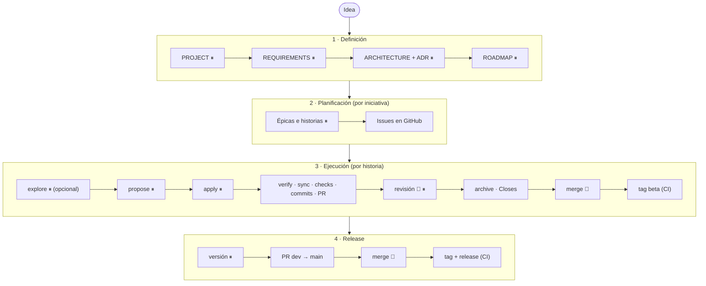

# WORKFLOW

Cómo se trabaja en este repositorio, desde la idea hasta producción. Vale para personas y agentes de IA. Convenciones: [`CONTRIBUTING.md`](CONTRIBUTING.md). Reglas de la IA: [`AGENTS.md`](AGENTS.md).

## 1. Visión general



⏸ parada para aprobación humana · 👤 acción humana · (CI) lo hace GitHub Actions al mergear. Entre paradas, la IA encadena los pasos sin esperar órdenes e informa al llegar.

**Quién decide.** La persona decide el producto, el alcance, los requisitos, qué historia se hace, el plan de cada una, qué se mergea y qué se publica. La IA propone, ejecuta y comprueba: redacta, implementa, valida, mantiene la documentación y prepara commits y PRs.

## 2. Mapa de documentación

Cada dato tiene un único documento dueño; los demás lo enlazan en lugar de copiarlo. Si un dato aparece duplicado o contradictorio, prevalece su dueño.

| Documento | Fuente de verdad de |
|---|---|
| [`README.md`](README.md) | Presentación del proyecto y puesta en marcha |
| [`WORKFLOW.md`](WORKFLOW.md) | Fases, paradas, mapa de documentación y herramientas |
| [`CONTRIBUTING.md`](CONTRIBUTING.md) | Idioma, modelo de trabajo, Ready/Done, ramas, commits, Issues, PRs y versiones |
| [`AGENTS.md`](AGENTS.md) | Reglas de la IA: contexto, autonomía, OpenSpec, GitHub, ingeniería y tests |
| [`docs/PROJECT.md`](docs/PROJECT.md) | Visión, objetivos (`OBJ`), alcance, restricciones, riesgos y decisiones de producto (`DEC`) |
| [`docs/REQUIREMENTS.md`](docs/REQUIREMENTS.md) | Requisitos (`RF`, `RNF`, `RD`), glosario y criterios de aceptación de producto |
| [`docs/ARCHITECTURE.md`](docs/ARCHITECTURE.md) | Stack, componentes, datos, operación, calidad y despliegue (actual y objetivo) |
| [`docs/ADR/`](docs/ADR/README.md) | Razonamiento de las decisiones técnicas significativas |
| [`docs/CONTRACTS/`](docs/CONTRACTS/README.md) | Interfaces estables entre componentes y su versionado |
| [`docs/ROADMAP.md`](docs/ROADMAP.md) | Hitos, iniciativas, épicas y dependencias entre ellas |
| [`docs/ISSUE_LABELS.md`](docs/ISSUE_LABELS.md) | Nombre, uso y color de cada etiqueta |
| GitHub Issues | Historias, tareas, estado, jerarquía y bloqueos |
| `openspec/changes/` | Propuesta, delta de specs, diseño y tareas del cambio en curso |
| `openspec/specs/` | Comportamiento implementado y verificado |

### Trazabilidad

```text
OBJ-n (PROJECT) → RF-n (REQUIREMENTS) → épica (ROADMAP + Issue) → historia (Issue)
  → cambio de OpenSpec → PR → spec (openspec/specs/)
```

Cada eslabón cita el ID del anterior.

### Qué actualizar cuando algo cambia

Al cerrar una historia solo se actualiza lo que el cambio afecta:

| Si el cambio… | Se actualiza |
|---|---|
| Añade o cambia comportamiento | Las specs, mediante `sync` |
| Cambia la intención de producto | REQUIREMENTS o PROJECT, solo si figuraba en el plan aprobado |
| Cambia componentes, stack, datos, operación o despliegue | ARCHITECTURE |
| Toma una decisión técnica significativa | Un ADR nuevo y su índice |
| Cambia una interfaz entre componentes | El contrato y su versión |
| Cambia cómo se arranca el proyecto | README, sección de puesta en marcha |
| Muestra que el plan debe cambiar | El ROADMAP, solo con aprobación: se propone, no se aplica |

## 3. Herramientas

1. **OpenSpec** (Node.js 20.19.0 o superior) y **GitHub CLI** autenticado con permiso de escritura en Issues, etiquetas y PRs (`gh auth login`).

   ```sh
   npm install -g @fission-ai/openspec@latest
   ```

2. **La integración de OpenSpec para tu herramienta de IA**, con el perfil expandido, que incluye `verify`:

   ```sh
   openspec init
   openspec config profile
   openspec update
   ```

   `openspec/config.yaml` está versionado y `init` lo respeta. Las integraciones generadas no se versionan: `.opencode/` y `.claude/` ya están en `.gitignore`; si usas otra herramienta, añade su carpeta.

## 4. Fase 1 — Definición

La idea se convierte en los documentos base, en este orden: PROJECT → REQUIREMENTS → ARCHITECTURE (+ADR) → ROADMAP. Cada uno se deriva del anterior ya aprobado.

1. Se trabaja en la rama `docs/project-definition`, creada desde `dev`.
2. Para cada documento, la IA hace solo las preguntas imprescindibles y redacta un borrador corto. Lo no confirmado va a «Preguntas abiertas». Los documentos crecen con el proyecto.
3. ⏸ La persona aprueba el documento. La IA hace commit y pasa al siguiente.
4. Al aprobar el ROADMAP, la persona autoriza también el PR a `dev`.

**Cambios posteriores.** Cuando cambia el producto (un requisito nuevo, otro alcance, una iniciativa nueva), se repite esta fase solo para los documentos afectados: rama `docs/` propia, la misma parada y un PR a `dev`.

## 5. Fase 2 — Planificación

Se planifica una iniciativa cada vez, la siguiente del ROADMAP, que se revisa al terminar cada iniciativa.

1. La IA propone en el chat las épicas de la iniciativa y sus historias: objetivo, criterios de aceptación, tareas previstas, requisitos cubiertos y bloqueos, siguiendo los [vertical slices](#vertical-slices).
2. ⏸ La persona aprueba el desglose, lo que autoriza el resto de la fase.
3. La IA crea en GitHub las etiquetas que falten, las épicas y las historias (sub-issues de su épica, con sus bloqueos), y marca `ready` las que cumplen la [definición de Ready](CONTRIBUTING.md#definición-de-ready).
4. La IA enlaza las épicas en el ROADMAP y publica ese cambio en un PR `docs/` a `dev`.

El ROADMAP llega hasta las épicas. Las historias y sus tareas viven solo en GitHub.

### Vertical slices

El trabajo se divide en resultados que funcionan de extremo a extremo, no en capas técnicas.

- **Iniciativas y épicas** son capacidades de producto («generar una publicación desde un briefing»), no componentes («backend», «frontend», «base de datos»).
- **La primera épica es un *walking skeleton***: el camino más fino que atraviesa todos los componentes y funciona en desarrollo, con los checks del stack en el CI. Valida la arquitectura antes de desarrollar a fondo ninguna capa.
- **Cada historia** cruza las capas que necesita, deja el sistema funcionando y se puede demostrar.
- **El trabajo técnico** (infraestructura, configuración, refactor) va dentro de la historia que lo necesita. Si es demasiado grande, es una historia propia que desbloquea un slice concreto, nunca una épica de capa.
- **El orden** prioriza los slices que más riesgo reducen o que antes validan las decisiones abiertas.

## 6. Fase 3 — Ejecución de una historia

Se trabaja una historia cada vez.

1. **Preparar.** La persona elige la historia, normalmente la siguiente en orden. La IA comprueba la definición de Ready y crea la rama desde `dev` actualizado. Si hay bloqueos abiertos, lo indica y no empieza.
2. **Explorar, si hace falta.** Si el requisito o el enfoque no están claros, la IA usa `explore`.

   ⏸ **Parada 1 — exploración** (solo si se usó `explore`). La persona revisa las conclusiones.

3. **Proponer.** La IA usa `propose` para crear la propuesta, el delta de specs, el diseño y las tareas.

   ⏸ **Parada 2 — plan.** La persona revisa y aprueba los artefactos.

4. **Implementar.** La IA usa `apply`: implementa el alcance aprobado con sus tests y mantiene `tasks.md` al día. Si el plan no se sostiene, se detiene y propone un `update`.

   ⏸ **Parada 3 — implementación.** La IA presenta lo hecho, cómo probarlo y las desviaciones. La persona revisa el código y elige:
   - **Ajustes dentro del plan:** la IA los aplica y vuelve a esta parada.
   - **Cambiar el plan:** `update`, la persona aprueba los artefactos revisados y la IA vuelve a `apply`.
   - **Continuar:** la IA publica.

5. **Publicar, sin pausas:**
   1. `verify`, corrigiendo las discrepancias que estén dentro del alcance.
   2. `sync`.
   3. `openspec validate` y los checks del proyecto ([ARCHITECTURE §8](docs/ARCHITECTURE.md#8-calidad-tests-ci-y-observabilidad)).
   4. Documentación afectada ([§2](#qué-actualizar-cuando-algo-cambia)).
   5. Commits por bloques lógicos ([CONTRIBUTING §5](CONTRIBUTING.md#5-commits)).
   6. Push y PR a `dev` con `Refs #N`. En la historia anota el cambio de OpenSpec y marca las tareas entregadas.

   La IA avisa con el enlace al PR y el resultado de `verify` y de los checks. Si algo falla y la corrección no cabe en el alcance, se detiene e informa.

6. **Revisar.** 👤 La persona revisa el PR y el CI en GitHub. La IA publica en el mismo PR las correcciones que pida, sin volver a pedir permiso; si cambian el comportamiento, repite `verify` y `sync`.

   ⏸ **Parada 4 — PR revisado.** Con la revisión conforme y el CI en verde, la persona autoriza el cierre.

7. **Archivar.** La IA ejecuta `archive` en un último commit que solo contiene el archivo del cambio, lo publica y cambia en el PR `Refs #N` por `Closes #N`, más `Closes #E` si es la última historia abierta de su épica.
8. **Merge.** 👤 Con el CI en verde, la persona hace el merge a `dev`. GitHub cierra la historia y el CI crea el tag beta si el cambio afecta a la versión ([CONTRIBUTING §9](CONTRIBUTING.md#9-versiones-y-releases)).

## 7. Fase 4 — Release

Cuando la persona decide publicar una versión:

1. La IA propone la versión, que es la del último tag beta sin el sufijo, y lista las historias incluidas. Si no hay un tag beta posterior a la última versión estable, no hay versión nueva que publicar.
2. ⏸ La persona aprueba la versión.
3. La IA abre el PR `dev` → `main` con la versión y `Refs #N` de cada historia incluida.
4. 👤 La persona hace el merge a `main`.
5. El CI crea el tag `vX.Y.Z` y la GitHub Release, con notas generadas desde el último tag estable.
