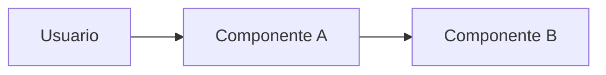

# ARCHITECTURE

> Cómo está construido el sistema y hacia dónde va. Mapa de documentación: [WORKFLOW](../WORKFLOW.md#2-mapa-de-documentación).

<!--
- Marca cada elemento como Actual (existe en el código), Objetivo (decidido, aún sin construir) o Candidata (por decidir).
- El porqué de las decisiones vive en los ADR, el detalle de las interfaces en CONTRACTS y el comportamiento en openspec/specs/. Aquí se resumen y se enlazan.
- Empieza con lo decidido y crece con cada historia que cambie la arquitectura (WORKFLOW §2, «Qué actualizar cuando algo cambia»).
-->

## 1. Visión general

[Qué piezas forman el sistema y cómo se relacionan, en un párrafo.]



## 2. Stack

| Área | Tecnología | Estado | Decisión |
|---|---|---|---|
| [Área] | [Tecnología] | Candidata | [ADR-0001 o —] |

## 3. Componentes

<!-- El nombre de cada componente sirve como scope en los commits (CONTRIBUTING §5). -->

| Componente | Responsabilidad | Datos que posee | Depende de | Estado |
|---|---|---|---|---|
| [Nombre] | [Qué hace y qué no hace] | [Datos] | [Componentes o servicios] | Objetivo |

## 4. Estructura del repositorio

```text
.
├── [componente-a]/
├── [componente-b]/
├── docs/
└── openspec/
```

## 5. Flujos principales

<!-- Un diagrama por cada flujo relevante, con sus casos de error. Enlaza el contrato de cada interfaz. -->

## 6. Datos, configuración y secretos

- **Persistencia:** [Qué se guarda, dónde y durante cuánto tiempo.]
- **Configuración:** [Variables de cada componente. `.env.example` contiene solo nombres y valores inocuos.]
- **Secretos:** [Qué componente los posee. Nunca van en el cliente ni en el repositorio.]
- **Datos enviados a terceros:** [Qué se envía, a quién y cuándo.]

## 7. Entorno local y operación

<!-- Requisitos previos, cómo arrancar todo o cada componente, puertos y comandos habituales. Si hay Makefile o scripts, son la fuente de verdad de los comandos; aquí solo se enumeran los importantes. -->

## 8. Calidad: tests, CI y observabilidad

<!-- Herramientas de test por tipo (unitario, integración, E2E), checks del CI, logs y métricas. Los principios de testing están en AGENTS.md, sección «Tests». -->

## 9. Despliegue

<!-- Dónde y cómo se despliega cada componente, qué está preparado y qué queda fuera de alcance. -->

## 10. Decisiones y contratos

- Decisiones técnicas: [índice de ADR](ADR/README.md).
- Interfaces estables: [índice de contratos](CONTRACTS/README.md).
