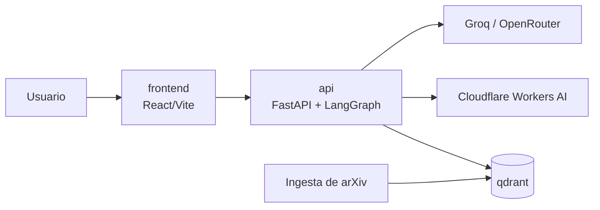
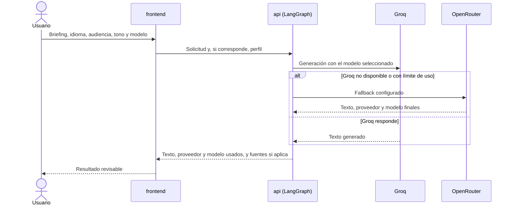
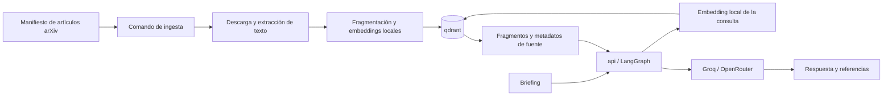

# ARCHITECTURE

> Cómo está construido el sistema y hacia dónde va. Mapa de documentación: [WORKFLOW](../WORKFLOW.md#2-mapa-de-documentación).

<!--
- Marca cada elemento como Actual (existe en el código), Objetivo (decidido, aún sin construir) o Candidata (por decidir).
- El porqué de las decisiones vive en los ADR, el detalle de las interfaces en CONTRACTS y el comportamiento en openspec/specs/. Aquí se resumen y se enlazan.
- Crece con cada historia que cambie la arquitectura (WORKFLOW §2, «Qué actualizar cuando algo cambia»).
-->

## 1. Visión general

Monorepo con servicios que se ejecutan juntos en local con Docker Compose y se pueden desplegar por separado más adelante ([ADR-0001](ADR/0001-docker-first-deployable-services.md)): una web estática, una API que ejecuta flujos de IA explícitos y es la única que habla con los proveedores, y una base vectorial para el conocimiento de arXiv. El usuario elige el flujo; la orquestación autónoma es futura. Aún no hay código: todo es Objetivo o Candidata.



## 2. Stack

| Área | Tecnología | Estado | Decisión |
|---|---|---|---|
| Interfaz web | React, Vite, TypeScript, Tailwind CSS y shadcn/ui; web estática servida como servicio propio | Objetivo | — |
| API | Python y FastAPI | Objetivo | — |
| Flujos de IA | LangGraph; LangChain para modelos, embeddings y recuperación donde aporte valor | Objetivo | — |
| Generación de texto | Groq como proveedor principal y OpenRouter como alternativo | Objetivo | — |
| Generación de imágenes | Cloudflare Workers AI, solo con modelo y cuota gratuitos, sin facturación ni fallback de pago | Candidata | Se confirma en I3-E1 |
| Embeddings | Modelo multilingüe local en el backend y la ingesta; BGE-M3 como candidato inicial | Candidata | Se decide en I4-E2 |
| Base vectorial | Qdrant, contenedor local con volumen persistente; remoto por configuración en el futuro | Objetivo | — |
| Almacenamiento de grafo | Por decidir; no entra en Compose hasta aprobar Graph RAG | Candidata | Se decide en I5-E1 |
| Entorno local | Docker y Docker Compose | Objetivo | [ADR-0001](ADR/0001-docker-first-deployable-services.md) |
| Comandos de desarrollo | Makefile (GNU Make) sobre `docker compose` | Objetivo | [ADR-0001](ADR/0001-docker-first-deployable-services.md) |
| Calidad | Herramientas de test, lint y tipos por decidir | Candidata | Se decide en I1-E1 |
| Despliegue futuro | Railway para frontend y API como servicios separados; Vercel como alternativa para la web | Candidata | — |
| Evolución posterior | WebLLM para generación en el navegador; Supabase/PostgreSQL para persistir perfil e historial | Candidata | — |

## 3. Componentes

<!-- El nombre de cada componente sirve como scope en los commits (CONTRIBUTING §5). -->

| Componente | Responsabilidad | Datos que posee | Depende de | Estado |
|---|---|---|---|---|
| `frontend` | Recoge el briefing y la configuración, ofrece las capacidades disponibles y presenta el resultado. No contiene claves de proveedores | Perfil del creador (`localStorage`) | `api` | Objetivo |
| `api` | Servicio FastAPI (`backend/`): valida solicitudes, aplica el catálogo de modelos, recibe el perfil solo si el usuario lo activa y ejecuta el flujo elegido. Sin estado persistente | Secretos de proveedores (entorno) | `workflows`, `providers`, `knowledge` | Objetivo |
| `workflows` | Flujos explícitos de LangGraph: generación directa y, según se implementen, recuperación, imagen y evaluación | — | `providers`, `knowledge` | Objetivo |
| `providers` | Pasarela de modelos (Groq con fallback a OpenRouter) y servicio de imagen (Cloudflare Workers AI). Informa del proveedor y el modelo efectivos | — | Groq, OpenRouter, Cloudflare | Objetivo |
| `knowledge` | Ingesta de arXiv, embeddings locales y recuperación en Qdrant; más adelante, relaciones de Graph RAG | Manifiesto versionado de artículos | `qdrant`, arXiv | Objetivo |
| `evaluation` | Herramientas internas para ejecutar casos y comparar prompts, modelos o flujos; separadas de la interfaz para creadores | Resultados locales de evaluación (formato por definir) | `workflows` | Objetivo |
| `qdrant` | Base vectorial con la imagen oficial | Fragmentos, vectores y metadatos de fuente | — | Objetivo |

## 4. Estructura del repositorio

Estructura objetivo; todavía no existe.

```text
.
├── frontend/
│   ├── Dockerfile
│   └── src/
├── backend/
│   ├── Dockerfile
│   └── app/
│       ├── api/             # Rutas y contratos HTTP
│       ├── workflows/       # Flujos explícitos de LangGraph
│       ├── providers/       # Groq, OpenRouter y Cloudflare
│       ├── knowledge/       # Ingesta, embeddings y recuperación
│       └── evaluation/      # Herramientas internas de evaluación
├── docker-compose.yml
├── Makefile
├── .env.example
├── docs/
└── openspec/
```

## 5. Flujos principales

### Generación directa



- El fallback a OpenRouter solo se activa por indisponibilidad, límite o *rate limit* de Groq; los errores de validación de la solicitud no lo activan. Si el fallback cambia de modelo, la respuesta lo indica.
- Si la imagen falla o se agota la cuota de Cloudflare, el error se comunica sin perder el texto.
- Contrato `frontend` → `api`: se registra en [CONTRACTS](CONTRACTS/README.md) en I1-E1, junto con su contrato de error.

### RAG



- La ingesta es un comando bajo demanda que reutiliza la imagen del backend; no hay un servidor de ingesta permanente. Procesa una lista versionada de identificadores de arXiv y no incluye PDF grandes en Git.
- Cambiar la versión o la dimensión del modelo de embeddings obliga a reconstruir la colección de Qdrant; no se mezclan vectores de modelos incompatibles.
- Graph RAG usará relaciones de citas entre artículos y conceptos compartidos, y Qdrant seguirá siendo la base vectorial.

## 6. Datos, configuración y secretos

- **Persistencia:** el perfil vive en el `localStorage` del navegador y queda ligado a su origen, así que no se comparte entre `localhost` y un dominio desplegado. Qdrant guarda fragmentos, vectores y metadatos en un volumen de Compose. La API no persiste briefings, generaciones, imágenes ni metadatos de ejecución: los devuelve en la respuesta.
- **Configuración:** cada servicio se configura por entorno. La web recibe la URL de la API al compilar; la API configura sus orígenes CORS (local y dominio futuro) y la URL y clave de Qdrant (local o remoto). `.env.example` contiene solo nombres y valores inocuos.
- **Secretos:** las claves de Groq, OpenRouter y Cloudflare solo están en el backend, como variables de entorno. El navegador nunca llama a un proveedor con un secreto.
- **Datos enviados a terceros:** el briefing, y el perfil si el usuario lo activa, van al proveedor de texto elegido; la petición de imagen va a Cloudflare cuando se solicita.
- **Acceso:** sin cuentas ni multiusuario. Antes de abrir una instancia pública hay que resolver la protección de acceso, los límites de uso y el abuso de cuota.

## 7. Entorno local y operación

- **Docker Compose** levanta como mínimo `frontend`, `api` y `qdrant`; la ingesta se ejecuta bajo demanda. Cada servicio de aplicación tiene su Dockerfile, configuración externa y comprobación de salud.
- **Makefile:** es la fuente de verdad de los comandos, con operaciones globales y por servicio: construir y descargar imágenes; iniciar, detener, reiniciar y consultar el estado; ver logs y abrir una consola; ejecutar la ingesta; limpiar artefactos y, en un comando separado y explícito, borrar volúmenes. Ejemplos: `make up`, `make up-api`, `make pull-qdrant`, `make logs-frontend`, `make ingest`. No usa sintaxis exclusiva de Bash, para funcionar en Windows, macOS y Linux con GNU Make.

## 8. Calidad: tests, CI y observabilidad

Por decidir. El walking skeleton (I1-E1) elige las herramientas de test, lint y tipos de `frontend` y `api` y las añade al CI.

## 9. Despliegue

No se despliega nada en producción en esta fase; cuentas, planes, dominios y protección de acceso se deciden al planificar el despliegue.

- `frontend` y `api` se despliegan por separado desde sus Dockerfiles. Railway puede crear servicios separados desde un monorepo; el Compose local no se publica como una única aplicación ([monorepos](https://docs.railway.com/deployments/monorepo), [Docker Compose](https://docs.railway.com/guides/docker-compose)).
- Vite genera archivos estáticos que se pueden servir desde Railway o Vercel; en Vercel hay que configurar el fallback de rutas de la SPA y la URL pública de la API ([Vercel: Vite](https://vercel.com/docs/frameworks/frontend/vite)).
- La API no guarda estado de sesión. Qdrant se conecta por URL y clave a una instancia remota, y Cloudflare Workers AI se consume como API externa.

## 10. Decisiones y contratos

- Decisiones técnicas: [índice de ADR](ADR/README.md).
- Interfaces estables: [índice de contratos](CONTRACTS/README.md).
